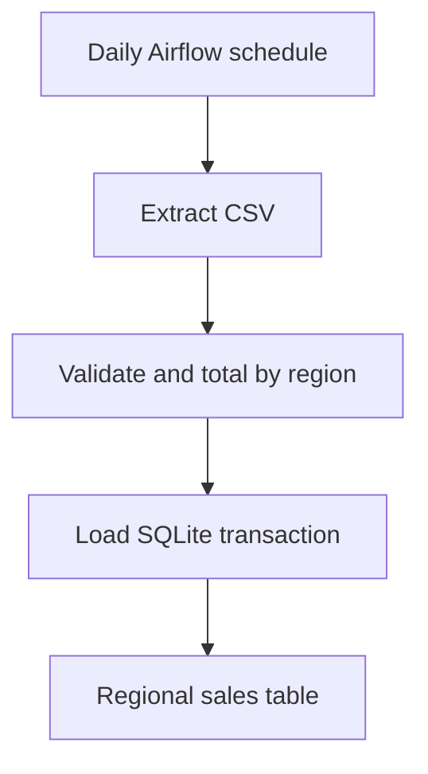

# Automated ETL with Apache Airflow

Schedule a daily batch that extracts a CSV, validates and aggregates orders, and loads a SQLite reporting table. This demo runs on a single machine with synthetic data.

## Architecture



## Run your first DAG

1. Install Python 3.11 and use Linux, macOS, or WSL on Windows. Clone the repository and open a terminal at its root.
2. Create an isolated environment and install Airflow with its matching constraints.

   ```sh
   python3.11 -m venv .venv
   . .venv/bin/activate
   python -m pip install -r requirements.txt \
     --constraint https://raw.githubusercontent.com/apache/airflow/constraints-2.10.5/constraints-3.11.txt
   ```

3. Set project-local paths and run the entire DAG once.

   ```sh
   export AIRFLOW_HOME="$PWD/.airflow"
   export AIRFLOW__CORE__DAGS_FOLDER="$PWD/dags"
   export AIRFLOW__CORE__LOAD_EXAMPLES=False
   airflow db migrate
   airflow dags test orders_etl 2025-01-02
   ```

4. Check the output with Python.

   ```sh
   python -c 'import sqlite3; db=sqlite3.connect("output/sales.db"); print(db.execute("SELECT * FROM regional_sales ORDER BY region").fetchall())'
   ```

   Expect `[('east', 2000), ('west', 1600)]`. Values are integer cents. Rerunning the DAG replaces the current snapshot in one transaction.

5. To use the scheduler and UI, run `airflow standalone` with the same environment variables. Go to `http://localhost:8080`, use the credentials printed by Airflow, and unpause `orders_etl`. Trigger a run from the UI or wait for its daily schedule. Stop the local services with Ctrl+C.

Use the task logs in the UI to trace a failure. This small demo passes records through Airflow XCom. For larger inputs, keep data in shared storage and pass references between tasks.
